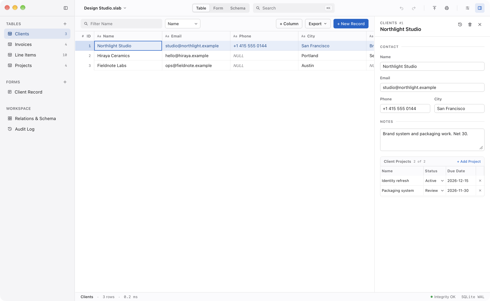
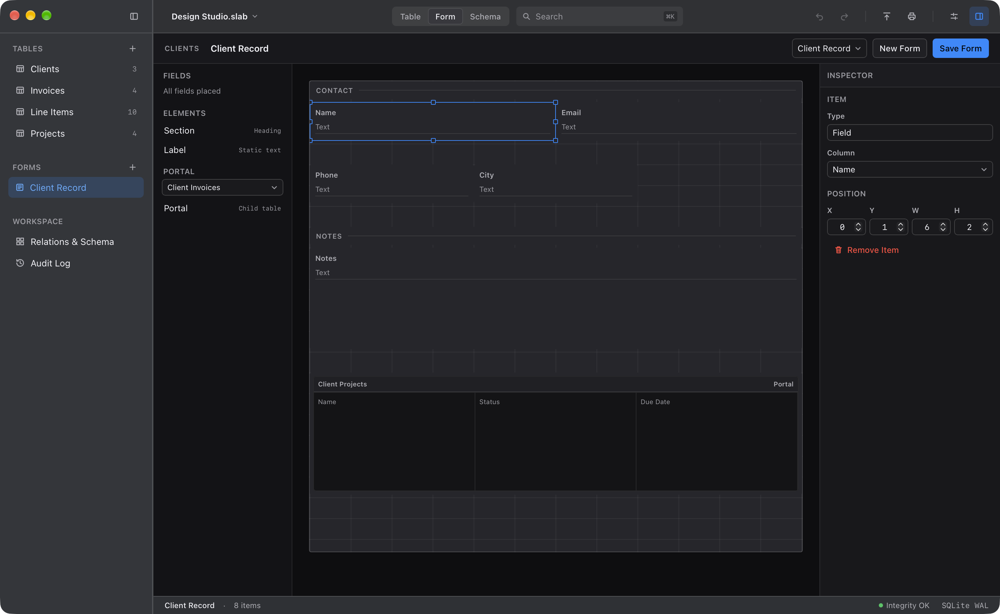
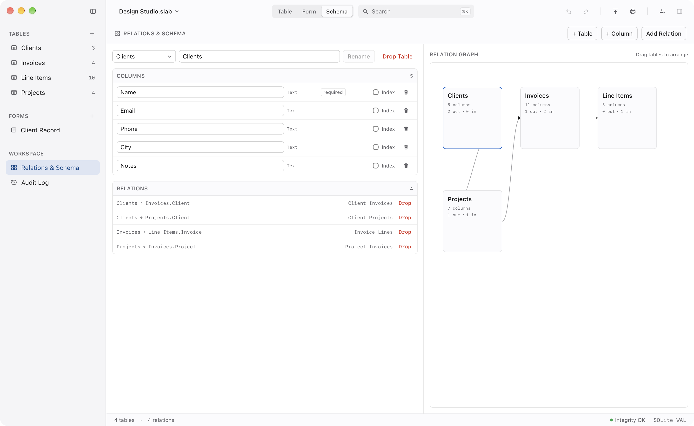
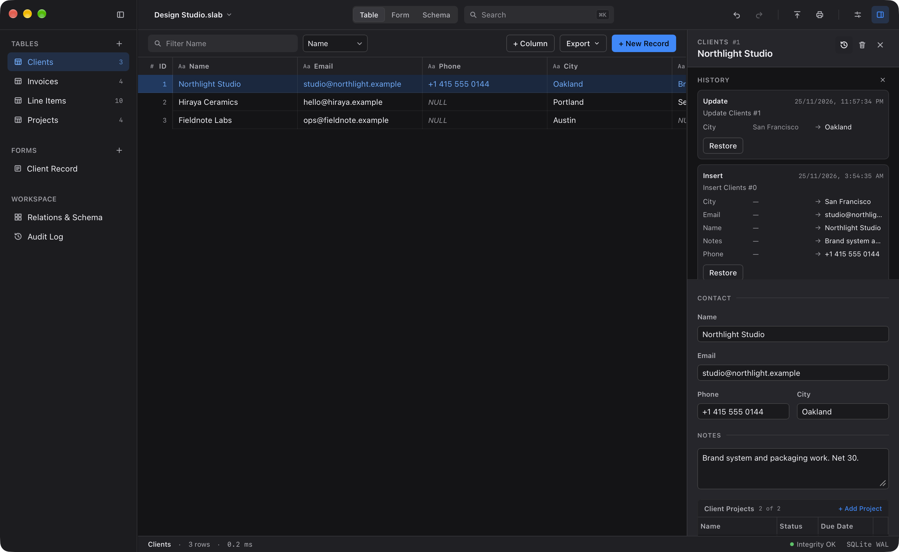

# SlabBase

SlabBase is a native Mac database and form studio for the work FileMaker has traditionally owned: typed relational tables, snap-to-grid form layouts, live child portals, and printable reports. Every workspace is an ordinary SQLite 3 database in WAL mode, so the same records remain readable with `sqlite3` today and with any SQLite client you can still build twenty years from now — no account, no lock-in, no proprietary container.



## Visual tour

### Forms that bind to the schema, not beside it



Fields, sections, labels, and child portals are placed on a 12-column grid with 30-pixel rows; the layout is stored as validated JSON in `_slab_layouts`, and every field resolves against the live table schema.

### One model for columns and relations



The split view keeps the typed column editor and the relation graph on the same schema: each 1:N relation creates a real foreign key, a secondary index on the child column, and a line in the monochrome map.

### Revisions you can read without a server



Every write appends a field-level before/after delta to `_slab_audit_log` and chains it with BLAKE3; `Restore` replays an earlier value as a new audited write that stays undoable with `⌘Z`.

## Why it feels fast

Fast is a budget, not an adjective. These are release-build numbers from `cargo run --release -p slab-storage --example systems_bench` on Apple silicon. The fixtures, assertions, and measurement code are in the repository.

| Path | Release measurement | Mechanism |
| --- | ---: | --- |
| Rollup read, 100k children | **0.018 ms** cached vs **3.701 ms** cold `SUM` — **205× faster** | Incremental `(count, sum, extreme)` parent state; no child scan on read |
| Keyset pagination, 100k rows | **1.48 ms** median / **2.86 ms** p95 over 1,000 pages | Cursor predicates and `LIMIT n + 1`; no count query, no full materialization |
| Index Advisor, first page at 100k rows | **3.02 ms → 0.104 ms** after one click | `EXPLAIN QUERY PLAN` detects the scan, creates the index, reopens the readers |
| Tuple IPC, 100 × 10 page | **35,073 → 23,205 bytes** (**33.8% smaller**) | Column names travel once per page; rows cross as positional tuples |
| APFS snapshot, 4.4 MB | **1.75 ms** clone vs **6.44 ms** `VACUUM INTO` | Copy-on-write `clonefile` under the writer lock, with a transactional fallback |
| 20k-row write under active reads | **Zero `SQLITE_BUSY` failures** | One serialized writer, four read-only WAL replicas, five-second busy timeout |

The 100k pagination test asserts a 15 ms p95 in release builds. That budget covers indexed keyset pagination; an unindexed arbitrary sort is deliberately not promised the same bound.

## Engineering principles

- **One writer, four readers.** Writes serialize through `BEGIN IMMEDIATE`; reads lease read-only WAL connections and see the last committed snapshot while an import is still open.
- **Exact money.** Currency and fixed-precision decimals are `i64` minor units with an explicit scale and `i128` intermediates. Binary floating point is never used for money.
- **Bounded by construction.** Grids and portals use keyset pagination and virtualized rows. No query materializes a full table.
- **Acyclic formulas.** Formula dependencies form a DAG; a schema change that would introduce a cycle is rejected before the transaction starts.
- **Audit is part of the write.** The data mutation, rollup adjustment, FTS update, before/after delta, BLAKE3 chain entry, and inverse command commit together.
- **No panics in shipping code.** Library crates deny `unwrap`, `expect`, and `panic`; errors carry stable `SLAB_E_*` codes such as `SLAB_E_CYCLE` and `SLAB_E_FK_VIOLATION`.

## Open format, not a promise

A `.slab` file is a SQLite 3 database. Point any SQLite client at it:

```bash
sqlite3 studio.slab '.tables'
sqlite3 studio.slab 'PRAGMA integrity_check; PRAGMA foreign_key_check;'
sqlite3 studio.slab 'SELECT Number, Total FROM Invoices;'
sqlite3 studio.slab 'SELECT * FROM _slab_audit_log ORDER BY id DESC LIMIT 3;'
```

User data lives in ordinary tables with real foreign keys. SlabBase metadata lives in `_slab_*` tables; no page of user data depends on a proprietary decoder. Closing the application checkpoints and truncates the WAL so the file is self-contained, while a crash still leaves a valid WAL database.

## Crates

`slab-core` is the floor. `slab-formula` sits on core. `slab-storage`, `slab-import`, `slab-print`, and `slab-sync` build on core and formula as needed and never depend on one another. `apps/desktop` depends on all of them and owns every process, thread, and synchronization boundary.

| Crate | Responsibility | Depends on |
| --- | --- | --- |
| `slab-core` | Domain types: values, exact decimals, schema, layouts, commands, queries | — |
| `slab-formula` | Parser, typechecker, evaluator, dependency DAG | `slab-core` |
| `slab-storage` | SQLite engine, reader/writer pool, DDL, pagination, search, rollups, audit chain, undo | `slab-core`, `slab-formula` |
| `slab-import` | Streaming CSV and JSON adapters with inference and preview | `slab-core` |
| `slab-print` | Layout to paginated HTML and PDF | `slab-core` |
| `slab-sync` | Hybrid logical clock, change sets, transport trait | `slab-core` |
| `apps/desktop` | Tauri shell, concurrent read pool, typed IPC, React UI | all of the above |

`slab-core` and `slab-formula` compile without filesystem, network, SQLite, or UI dependencies.

## Design and security

- [ARCHITECTURE.md](ARCHITECTURE.md) — dependency graph, storage schema, reader/writer concurrency, pagination, rollups, audit chain, and failure containment.
- [docs/DESIGN_CONTRACT.md](docs/DESIGN_CONTRACT.md) — the normative visual and interaction contract, enforced by the Playwright audit.
- [ROADMAP.md](ROADMAP.md) — shipped scope, next versions, known limits, and the workspace compatibility policy.
- [CHANGELOG.md](CHANGELOG.md) — release history and the unreleased v1.0 scope.
- [SECURITY.md](SECURITY.md) — reporting, scope, response targets, and security design notes.
- [CONTRIBUTING.md](CONTRIBUTING.md) — DCO, commit signing, the local gate, and commit style.
- [CODE_OF_CONDUCT.md](CODE_OF_CONDUCT.md) — community standards and enforcement.
- [docs/RELEASING.md](docs/RELEASING.md) — tag-to-draft release operations, Apple secrets, and attestation checks.

## Build from source

Prerequisites:

- macOS 13 or newer (Apple silicon or Intel).
- Rust 1.92 or newer with `rustfmt` and `clippy`.
- Node.js 22 or newer.
- Xcode command line tools.

```bash
npm --prefix apps/desktop ci
npm --prefix apps/desktop run tauri build
```

`tauri build` runs the Vite production build and the release Rust build, then bundles `target/release/bundle/macos/SlabBase.app`. Launch it with the sample workspace:

```bash
open target/release/bundle/macos/SlabBase.app \
  --args --workspace "$PWD/fixtures/design-studio.slab"
```

For development:

```bash
npm --prefix apps/desktop run tauri dev
```

## Verification

Run the full gate:

```bash
cargo fmt --check
cargo clippy --workspace --all-targets -- -D warnings
cargo test --workspace
cargo test --release -p slab-storage --test pagination
cargo test --release -p slab-storage --test systems
cargo run --release -p slab-storage --example systems_bench
cargo deny check
npm --prefix apps/desktop run typecheck
npm --prefix apps/desktop run build
npm --prefix apps/desktop exec -- playwright install chromium
npm --prefix apps/desktop run test:ui
```

The suite includes property tests for the formula language, randomized integer currency sums, a 100,000-row keyset pagination benchmark, randomized incremental-rollup parity against full SQL recomputation, BLAKE3 audit tamper detection through external `sqlite3`, Index Advisor and APFS snapshot checks, a shell-level concurrent-read test against an active import, an external `sqlite3` integrity check of a generated workspace, and undo/redo parity across portal edits.

For an auditable release binary:

```bash
cargo install cargo-auditable
cargo auditable build --release -p slabbase-desktop
otool -l target/release/slabbase-desktop | grep dep-v0
```

The release profile keeps the `.dep-v0` section used by `cargo-auditable`; `strip = "debuginfo"` does not remove it.

## v1.0 boundaries

SlabBase targets macOS. The storage format and core crates are platform independent; Windows and Linux builds are expected to work but are not part of the v1.0 verification matrix.

- PDF text is base-14 Helvetica with WinAnsiEncoding. Latin-1 and CP1252 text encodes exactly; unsupported scripts and emoji become `?`.
- User identifiers are ASCII up to 64 bytes; non-Latin names are rejected rather than quoted.
- Table PDF exports stop at an explicit 25,000-row ceiling and report that they did.
- The BLAKE3 audit chain is tamper-evident, not tamper-proof against an attacker who rewrites the entire chain. SQLCipher encryption at rest and external anchoring are v1.2 work.
- The v1.0 build does not encrypt data at rest.

See [ROADMAP.md](ROADMAP.md) for the complete known-limitations list and the compatibility policy.

## License

Apache License 2.0. See [LICENSE](LICENSE) and [NOTICE](NOTICE).

## Commercial support

Every feature in this repository is and remains Apache-2.0 open source. Organizations that need Apple-notarized, MDM-distributable `.pkg` installers, long-term security backports for pinned releases, or response-time support agreements can contact the maintainer through GitHub Issues or Discussions at [chiranjeevi-max/slabbase](https://github.com/chiranjeevi-max/slabbase). These offerings cover packaging, signing, and support; they never gate a product capability.
